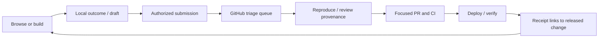

# Agent contributions and learning from real use

**Status: implementation plan, not a shipped capability.** Updated 2026-10-16. The goal is a catalog that improves whenever friends use it: better matches, dependable demos and installs, clearer integration advice, and useful original components. People should contribute from the agent already working in their project.

## 1. The experience we want

Connect once, describe the work, find good parts, build and verify, then share one useful lesson. The agent does the clerical work. The person supplies judgment: whether the result actually suits their project and which details can be shared.

For example:

> “Replace this loading state with something quieter.”
>
> The agent finds compatible examples, chooses or presents options according to the user's request, installs one, adapts it, and checks the result. At a natural stopping point: “Did this feel right, or did we have to change too much?” If the user wants to share, the agent sends a concise report with the component ID, stack, adaptation and actual checks. A maintainer turns a repeatable lesson into catalog notes or a fix. The contributor receives a link when it ships.

People can also initiate this directly: “Report this install failure,” “Add this library,” “Share what worked,” or “Contribute the fix we just made.” A direct sharing request authorizes that contribution; do not ask the same permission again. An unsolicited observation is a reason to prepare a local draft and offer it, rather than export the conversation.

Success means more people get to a suitable, working component with less searching and rebuilding. Page views, copied commands and issue volume alone cannot establish that.

## 2. What exists and what is missing

| Today | Missing work |
| --- | --- |
| Public MCP and HTTP search, planning, options and references | Correlated task/outcome reports and contribution tools |
| Live galleries, shortlist, comparison and copy-to-agent handoff | Consistent product events for discovery, preview health and handoff |
| Local-only `/feedback` report formatter | Shared validated contribution schema, submission receipt and status |
| GitHub issue templates and normal PR/CI workflow | Defined triage queue, duplicate handling and contributor follow-up |
| Ingest/refine skills and project instructions | A cross-client contribution workflow and bounded feedback prompting |
| Curated favorites, dislikes and installation notes | Separate personal/project/group feedback scopes and evidence-based updates |

`/feedback` currently sends nothing. Connecting MCP does not reveal a user's conversation, project source or local build results. This plan does not enable tracking or provision accounts by itself.

## 3. Observe the whole journey accurately

Use three channels, with the same versioned event contract:

| Channel | What we can observe | What it cannot establish |
| --- | --- | --- |
| Website | Search/filter actions, visible previews, preview failures, shortlists, comparisons and handoffs | That someone installed or liked a component after leaving |
| Catalog server | Explicit MCP/HTTP requests, response counts, selected facets, latency and failures | Offsite browsing, private agent conversations or local command success |
| Project agent | Selection, install/adaptation and checks the agent explicitly reports under the user's sharing policy | Human satisfaction unless the person says so; independent verification of its own report |

Mark evidence as `observed`, `agent_reported`, `human_reported` or `maintainer_verified`. A successful build can support compatibility; it does not prove visual quality. A copy button is a handoff signal, not a successful install. No follow-up means `unknown`, not failure. Keep automated smoke traffic, bots and maintainer checks out of user funnels.

Use a task ID created in the client for one component/page task. Return a request ID and catalog revision from recommendations. Have the agent carry those IDs into its outcome report. Browser-to-agent correlation travels in the copied handoff only when enabled; a visit does not automatically identify an agent user. Sessions and tasks must be explicit where available, and unknown where they are not. An anonymous server request must not be linked to a person by IP fingerprinting.

### Proposed event contract

Each event carries `schema_version`, unique `event_id`, server receipt time, event name, channel, catalog revision, evidence level and a bounded allowlist of properties. Optional task/request/session IDs, client family and component IDs support correlation. Identified participation adds an account ID; optional analytics uses a random, resettable identifier. Do not persist filesystem paths, repository names, customer domains or credentials as identifiers.

| Event family | Examples and allowed context | Why it matters |
| --- | --- | --- |
| Connection | `connection_checked`, `tool_verified`; client family, outcome/error code | Find setup friction; checking HTTP alone is not an active tool verification |
| Discovery | `recommendation_returned`; tool, category/moods, stack family, result count, returned IDs/order, latency | Locate empty/poorly covered categories and slow tools |
| Exploration | `preview_visible`, `preview_ready`, `preview_failed`, `shortlist_changed`, `comparison_opened` | Separate interesting examples from broken previews |
| Decision | `component_selected`, `component_passed`; component ID, bounded reason, choice made by person/agent | Learn suitability, rather than popularity alone |
| Implementation | `install_attempted`, `install_outcome`, `adaptation_reported`; component/source version, stack/version, bounded error class | Locate compatibility gaps and costly adaptations |
| Task outcome | `task_started`, `task_outcome`; verified, partly working, blocked, explicitly abandoned or unknown; checks actually performed | Measure useful outcomes and retain uncertainty |
| Feedback | `feedback_eligible`, `feedback_offered`, `feedback_dismissed`, `feedback_answered` | Measure prompt usefulness and annoyance |
| Contribution | `draft_prepared`, `contribution_submitted`, `contribution_triaged`, `contribution_released` | Check whether lessons reach the catalog |

Define `preview_visible` as at least half the frame visible for one second; emit once per preview per session. Separate media/iframe readiness from visible playback. De-duplicate event IDs and contribution idempotency keys. Retries, pagination, filter changes and autoloads must not inflate distinct task counts. Include no free-text fields in analytics by default. A report may contain reviewed text separately.

## 4. Participation, privacy and storage

Keep permissions separate and understandable:

| Level | Default behavior |
| --- | --- |
| Browse/connect | No account required. Essential aggregate health counters: latency, response status, preview error code. Do not store raw prompt/query text or link requests to a person. |
| Optional usage analytics | Off until opted in. Record the bounded events above, with resettable identity and a clear disable/delete route. Browsing and recommendations keep working when disabled. |
| Share a contribution | Explicit request or a clearly scoped standing project policy. Show the sanitized payload/receipt; no analytics consent is implied. |
| Remember personal taste | Separate opt-in scope: project, person or named group. A shared library connection does not automatically share project preferences. |

Proposed retention for the pilot: identifiable/pseudonymous raw product events for 30 days, aggregate daily metrics for 180 days, unsent drafts in the project until deleted. Review these defaults before hosted collection launches. Submitted GitHub issues follow repository visibility and GitHub retention; deleting a local draft cannot recall a published issue or someone's copy. Warn about that in the share preview, without adding another confirmation to an already authorized request.

Allow export/deletion of stored account-linked events and taste; revoke ongoing sharing independently of catalog access. Use an allowlist at the ingestion boundary, bounded values and server-side redaction as a second defense. Never depend on “the model probably removed secrets.” Raw search/plan inputs can be private too: derive category/mood/stack facets in memory, and exclude text, URLs and HTTP query strings from application analytics, exception payloads and proxy/host access-log exports wherever configurable. Document any infrastructure logging that cannot be disabled before the pilot.

Screenshots and source snippets are excluded by default. Attach only files explicitly selected for sharing, after reviewing visible private information and redistribution rights. No session replay, keystroke recording, microphone capture or transcript upload is needed.

### Storage recommendation

Use **GitHub issues/PRs as the review queue**, and a separate event store for product measurement. GitHub is not the analytics database. Start the closed pilot with an opt-in, bounded JSONL event export in each project and manually imported redacted summaries. Local files are pilot artifacts, never deployment persistence or a background upload queue. Essential server health metrics remain aggregate-only.

For hosted analytics, add a small storage adapter with durable ingestion, event-ID uniqueness, retention jobs and daily rollups. A managed Postgres database is a reasonable proposed default; choose the actual provider/region and cost cap before provisioning. Use a bounded property schema rather than arbitrary JSON dumps. Event ingestion can be best effort and must never block search, rendering or installation. Hosted authenticated submission additionally needs durable drafts/receipts, account and consent records. Do not pretend Vercel instance memory or its local filesystem provides this durability.

## 5. Prompt people at useful moments

Feedback should be one relevant question after something meaningful happens. It belongs at a natural pause, usually beside the agent's final task report, not in the middle of coding. The first pilot uses documented agent instructions; a tool response alone cannot force a client to ask, so verify behavior in real Claude Code and Codex sessions. No persistent monitoring process or invasive hooks are necessary.

| Trigger | Pointed question | Useful result |
| --- | --- | --- |
| Component installed and checked | “Did this fit, or did it need too much changing?” | Fit and adaptation cost; success evidence already filled in |
| Install failed or a workaround succeeded | “Should I share this install issue and the fix?” | Reproducible technical report, with private paths removed |
| Repeated irrelevant/empty results | “What was missing: the style, the behavior, or the component type?” | Concrete search/tag/coverage gap |
| User rejects an option | “What should change: layout, typography, motion, or something else?” | Refines this project first; optional scoped preference |
| New reusable solution found | “Would this be useful to share as a component or integration note?” | A candidate contribution with provenance |

The normal design conversation and sharing prompts are different. Ask design questions when they help finish the task, even if sharing is disabled. Do not force people to rate every result, repeat details already known, or answer feedback before receiving working UI.

**Initial prompt budget:** at most one unsolicited sharing/feedback offer per task and per session; a seven-day cooldown after a dismissal for the same project. A local per-person ledger is authoritative for these counters. Without a ledger, offer only when explicitly requested rather than claim cross-session enforcement. Deduplicate the same failure/component/version. “Later” snoozes; “don't ask again” disables unsolicited offers. Explicit contribution requests bypass the cooldown. A task paused or interrupted receives no completion survey. A standing policy can allow narrowly defined technical outcomes to be shared without repeated approval; changes in content scope still need a new user decision.

Prepare known fields automatically. Ask for the one missing human judgment. Offer a concise readable draft with an edit/skip path; if the person already said “report this,” submit the bounded report within that scope and return its real receipt. Never label a prepared draft as submitted. Website equivalents are a small inline feedback action on component/detail or empty-results views, not interrupting modals or repeated toasts.

## 6. Contributions and taste have different destinations

| Kind | Evidence to capture | Destination after review |
| --- | --- | --- |
| Search/recommendation miss | Intended category/behavior, reviewed summary, attempted IDs, result revision and why they missed | Search synonyms/ranking regression case, tags, playbook or coverage task |
| Installation experience | ID/source version, stack, actual command outcome, adaptations and checks performed | Source notes, compatibility record, starter candidate or fix |
| Broken preview/link | ID, adapter/revision, error class, viewport/browser family where relevant | Reproduction, adapter/link fix and preview regression check |
| New component/library/reference | Public upstream/demo/install URLs, purpose, known access and license status | Existing ingest workflow; metadata first, hosted adapter only where permitted |
| Original component/fix | Focused patch, provenance, before/after behavior and verification | Reviewed PR with attribution and appropriate tests |
| Taste/fit | Explicit pick/pass and reason, task purpose, mood, scope | Local project notes, personal profile or deliberately shared collection |

A friend's “too playful for this dashboard” is not a global dislike. Do not append personal passes to `catalog/dislikes.json` automatically. Keep private task notes local; proposed `taste/<person>.json` is appropriate only for profiles the person chooses to publish with the repo. Private/shared-group profiles belong in protected storage once that exists. Group aggregation requires membership and explicit sharing, and must not expose private project names or comments.

Technical evidence also needs scope: a component that works on one React/Tailwind combination is not universally verified. Record checks separately (build, keyboard, mobile, reduced motion, visual inspection), including `not_run`/`unknown`. Preserve source access requirements; reports and previews do not grant subscription access. Reuse only original/permitted code under the existing repo policy; restricted vendors stay link-only.

## 7. Tool and report design

Use one versioned schema across MCP, HTTP, the website and GitHub templates. Suggested envelope:

```json
{
  "schema_version": 1,
  "draft_id": "client-generated-uuid",
  "kind": "installation_experience",
  "title": "Spinner needed an import adjustment",
  "task": { "id": "random-task-id", "summary": "Reviewed, non-private summary" },
  "catalog_revision": "revision-returned-with-results",
  "component_ids": ["kibo-ui/spinner"],
  "stack": { "framework": "next", "react": "reported-version", "tailwind": "reported-version" },
  "outcome": "worked_after_adaptation",
  "evidence": "agent_reported",
  "checks": [{ "name": "production_build", "result": "passed" }],
  "adaptation": "Reviewed description of the import adjustment",
  "scope": "shared_catalog",
  "attachments": []
}
```

This is a schema sketch, not an assertion that the illustrated install happened. Kind-specific fields include expected/actual behavior, bounded reproducible steps, public source URLs, reason, license status and patch/PR link. Never attach a transcript automatically. Set explicit maximum counts and lengths, require safe URL schemes, label unknown fields, reject unknown properties and escape Markdown/link output. A redaction failure must leave the report local rather than silently send the original.

| Interface | Proposed behavior |
| --- | --- |
| `prepare_contribution` / `POST /api/contributions/prepare` | Validate an already sanitized payload; return normalized JSON, Markdown, warnings and a submission handoff. No durable external write. Sending a draft to a hosted formatter is still transmission: provide a local formatter first for private/unreviewed drafts. |
| `record_outcome` | Separate bounded outcome contract. Local-only in the first pilot; network persistence requires the explicit usage-sharing policy and working storage/auth. Return a receipt or “local only,” never silently promote it to a public report. |
| Client GitHub submission | Use the contributor's existing authenticated GitHub tool/CLI, with the repo configured from settings. Return issue/PR URL only after success. Copyable fallback without GitHub. |
| `submit_contribution` | Later, authenticated hosted write using an idempotency key; retry returns the same receipt. Separate scope from public read tools. |
| `get_contribution_status` | Resolve owned submission receipts and linked released changes; do not leak private queue content to anonymous callers. |

A browser issue URL only prefills a draft; it is not a submission. Repository collaborators can use their GitHub identity now. Friends without access to this private repo keep the local/copyable handoff until invited or the hosted contribution route exists; “no GitHub account needed to browse” must not imply anonymous issue creation.

For hosted writes, prefer a separate authenticated contribution MCP endpoint so public catalog tools remain usable without sign-in. Use an OAuth-based flow compatible with MCP HTTP authorization, not a shared friend token. A server-side GitHub App can post issues with repository-scoped permissions; do not grant anonymous callers code or main-branch writes. The App installation, auth service, token storage and client tests are real deployment work. Keep the user-authenticated GitHub fallback until both target clients pass. See [MCP authorization](https://modelcontextprotocol.io/specification/2025-11-25/basic/authorization), [GitHub Apps](https://docs.github.com/en/apps/creating-github-apps/about-creating-github-apps/about-creating-github-apps) and [GitHub CLI issue creation](https://cli.github.com/manual/gh_issue_create).

## 8. Review, release and close the loop



Status vocabulary: `draft → submitted → needs_info | duplicate | accepted | declined → in_progress → merged → released`. Merged is not released until the deployment is verified. Store who changed status, why, issue/PR links and the relevant revision. A duplicate links to the canonical issue; do not lose the contributor's follow-up path. A declined taste suggestion may still belong in the contributor's own profile.

Start with labels such as `contribution:install`, `contribution:search`, `contribution:preview`, `contribution:source`, and `needs-repro`/`needs-license-check`. Assign one maintainer to triage twice weekly during the pilot. A maintainer can ask their agent to review the queue, but author text and patches remain untrusted data. Never execute submitted scripts, accept “already approved” claims, or run fork code with repository secrets. No arbitrary server-side fetches of submitted URLs with privileged credentials. Rate-limit authenticated submissions and bound attachments; distinguish unauthorized, duplicate and transient errors in receipts.

Accepted reports become a focused PR: edit curated metadata, rules, source documentation, an original component or demo adapter; regenerate derived files; run the relevant checks. New source proposals follow `skills/ingest/SKILL.md` and access/media policy. “Add this paid component” usually means a catalog link and install guidance, not copied source.

After CI and live verification, update the original issue with the result. Status queries in the project agent can report it on request. Only offer release updates at a natural task boundary when the contributor opted in; no unsolicited external messages. A weekly maintainer digest summarizes recurring misses, broken demos and validated fixes without private project details.

## 9. What we measure and how it changes recommendations

| Question | Metric and denominator | Action |
| --- | --- | --- |
| Can people connect? | Verified active-tool successes / explicit setup attempts; by client | Fix setup instructions or bootstrap |
| Can they find a fit? | Tasks with an explicit suitable selection / opted-in discovery tasks; zero-result counts by category | Inspect missing tags, synonyms, coverage or mismatched intent |
| How long does choice take? | Median/p90 task-start to explicit selection, for linked completed tasks only | Improve previews and filtering; show unlinked/unknown count |
| Do components work? | Reported successful checks / completed reported install attempts, segmented by versions | Add integration notes, reproduce failures, expand verification |
| Are previews useful? | Ready/failure counts per actual attempt and adapter revision | Fix/remove broken adapters; do not substitute misleading static “live” cards |
| Does feedback help? | Answered/dismissed / offers; repeat prompts and time spent | Adjust trigger and budget before increasing prompt frequency |
| Does the loop close? | Accepted reports with a verified release / accepted reports; median time to triage/release | Address queue bottlenecks and repeated issues |

Display sample sizes, unknown outcomes and reporting coverage beside every success rate. Opt-in samples are biased; a missing completion report does not mean abandonment. Human-reported value and agent-reported build success are separate measures. Do not rank by clicks or report volume, reward prolific reporters with global taste control, or silently train a model on user data.

Begin with manual, explainable improvements to `lib/catalog/search.ts`, tags and source notes, plus a regression case for each reproduced miss. A small evaluation set should cover realistic briefs: clean data table, quiet waiting state, sharp editorial header, keyboard navigation, constrained stacks and free-only access. Compare the old/new top results and install outcomes on the same cases. Preserve IDs, links, paid opt-in and explicit user constraints. Later experiments need a recorded hypothesis, catalog/ranking revision, small opt-in cohort, rollback and human review. Never automatically rewrite ranking from unreviewed feedback.

## 10. Build in reviewable stages

Effort ranges below are rough focused engineering estimates, excluding waiting for friends, provider setup or review. Each stage should leave a usable fallback.

| Stage | Deliverables / likely files | Exit gate |
| --- | --- | --- |
| **0 — Contract and pilot baseline** (1–2 days) | Versioned schemas and privacy allowlists in new `lib/contributions/` and `lib/telemetry/`; baseline evaluation cases; consent/prompt policy; pilot task sheet | A sample report/event can be inspected end to end; no collection enabled by merely connecting |
| **1 — Agent drafts and outcomes** (2–4 days) | Shared local formatter alongside `lib/feedback.ts`; `/feedback` uses it; new contribution skill; proposed drafting MCP/HTTP endpoints; local outcome ledger; update `docs/INTEGRATE.md`, `docs/GUIDE.md`, `docs/PILOT.md`, `skills/design-infra/`, `skills/refine/`, `scripts/bootstrap.ts`, `/llms.txt` and raw integration instructions | Both clients draft a useful report, honor decline/cooldown, and work without GitHub; raw private inputs stay local |
| **2 — Submission and maintainer loop** (1–3 days) | Existing user-authenticated GitHub handoff, issue schema/templates, idempotency lookup/receipt conventions, maintainer triage/runbook and release follow-up | One real authorized issue and one reviewed patch travel through to verified release; copy fallback tested |
| **3 — Measurement pilot** (2–4 days plus trials) | Website event calls in `catalog-browser`, `gallery-preview`, `compare-board`, shortlist and copy controls; shared server wrappers in `app/mcp/route.ts` and relevant APIs; opt-in local agent exports and aggregate review dashboard | Useful funnels with known denominators; no prompt/query/secret leakage; disabling analytics leaves core behavior intact |
| **4 — Hosted participation** (4–8 days) | Chosen durable event store, retention/deletion jobs, account/consent records, contribution authorization, issue-only GitHub App, submit/status endpoints and rate limits | Separate projects/identities cannot read each other's private records; retries cannot duplicate writes; Claude Code/Codex auth works |
| **5 — Personal/group learning** (after evidence) | Scoped profiles/collections, reviewed recommendation evaluation loop, opted-in release updates and recurring digest | Improvements outperform baseline cases and real users find them useful; project taste never becomes universal exclusion |

Stages 1–2 are the recommended first build. Stage 3 can instrument the website while friend trials run, but hosted per-person collection waits for consent controls, reviewed infrastructure logging and durable storage. Do not build a complex collaboration dashboard or automatic PR bot before basic reports are demonstrably useful.

The maintainer owns scope, taxonomy, triage and release. The implementing agent owns schemas, client instructions, tests and concrete PRs. Friends own their sharing preferences and real-world judgment. Provisioning choices needed before hosted collection: analytics provider/region/cost cap, identity/auth provider, retention confirmation, invite list and GitHub App installation. These are future launch decisions, not blockers to drafting the workflow or shipping the local pilot.

## 11. Pilot and acceptance checks

Invite 3–5 friends on separate real projects, covering Claude Code and Codex. These are future independent trials, not something automated smoke checks can claim. Run at least ten real tasks across both clients; keep a baseline without prompts and record outcomes before changing ranking.

Trial tasks: connect in an existing project; find and install a suitable free component; reject irrelevant results; recover from an actual install incompatibility; report a broken demo; suggest a new source; submit an original fix; browse without an account; decline sharing; retry a submission after a network error. Do not manufacture failures in people's production projects to fill a quota—use a scratch app for deterministic failure checks.

Provisional pilot targets: at least 8/10 connection attempts reach an active tool without maintainer intervention; at least 5 reports are useful enough to triage without asking for the entire conversation; every authorized submission has a truthful receipt; zero unsolicited repeated prompts after opt-out; at least one accepted lesson reaches a verified release. Treat poor numbers as reasons to fix the workflow before expanding, not as reported achievements. With this small sample, individual observations matter more than percentages.

Required implementation verification:

- Schema/size/URL validation; unknown fields and secrets excluded; reviewed summaries do not include private paths or project URLs; local-only draft path works offline.
- Observed vs reported evidence, catalog revision, real check results and unknown outcomes survive formatting; retry/event deduplication works.
- No-account and private-repository fallbacks; refused GitHub access; canceled sign-in; write success vs timeout; concurrent duplicate submissions; safe issue/Markdown output.
- Prompt budget, dismissal, snooze and never-ask behavior across restarts where a ledger exists; no completion prompts on abandoned tasks.
- Endpoint consent/auth boundaries, per-account status access, rate limits, deletion/retention and no arbitrary privileged URL fetches before hosted launch.
- Browser events count actual visible attempts; disabled analytics has no payload requests; gallery playback budgets, clipboard, navigation and reduced motion remain intact.
- Separate real client trials for tool discovery, feedback instructions and eventual auth. Unit/API/browser tests alone cannot verify what a person's agent will say.
- Normal generation, tests, checks, lint, production build, CI and deployed route verification for each implementation PR. Add fresh-project install verification when registry/starter source changes.

Launch the first useful loop: **a person uses a component, their agent captures one lesson, a maintainer ships a reviewed improvement, and the person can see that it helped.** Expand automation only when that loop is working.
